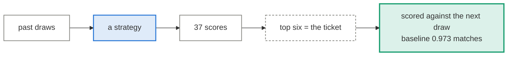

# Simple strategies, and what comes after

Every method on these pages answers the same question, *which six numbers next?*, through the
same socket: it sees the draws so far and returns a score for each of the 37 numbers. That makes
them directly comparable, and it makes this chapter a ladder from the simplest idea to the most
elaborate.

## The ladder

| Step | Page | The belief it tests | Code |
|---|---|---|---|
| 1 | [Statistical strategies](statistical.md) | Counting the past reveals tendencies: hot, cold, overdue, pairs | `lotto/approaches/statistical.py` |
| 2 | [The perfect-fit function](perfect-fit.md) | A function through every past draw continues into the future | `lotto/approaches/perfect_fit.py` |
| 3 | [Chaos theory](chaos.md) | The machine is deterministic, so similar pasts have similar futures | `lotto/approaches/chaos.py` |
| 4 | [The golden ratio](golden-ratio.md) | Nature's constant organises these numbers too | `lotto/approaches/golden_ratio.py` |
| 5 | [The first attempt](legacy-models.md) | Treat draws as a sequence to translate | `legacy/` |
| 6 | [Neural set prediction](set-prediction.md) | A network can learn which numbers, if the target is posed correctly | `lotto/approaches/neural.py` |
| 7 | [Date-conditioned generative model](date-conditioned.md) | The date itself carries information | `lotto/approaches/date_conditioned.py` |

Each page has the same shape: what the method believes, how it computes, the specific mechanism
by which it fails, and what it scored. The current numbers for all of them are on the
[live scoreboard](../results.md).

## Adding your own

Subclass `Predictor` from `lotto/approaches/statistical.py`, implement
`scores(history)`, and add it to `statistical_suite()`. The backtest hands your strategy only
draws that came before the one it is predicting, so it cannot cheat by accident.
