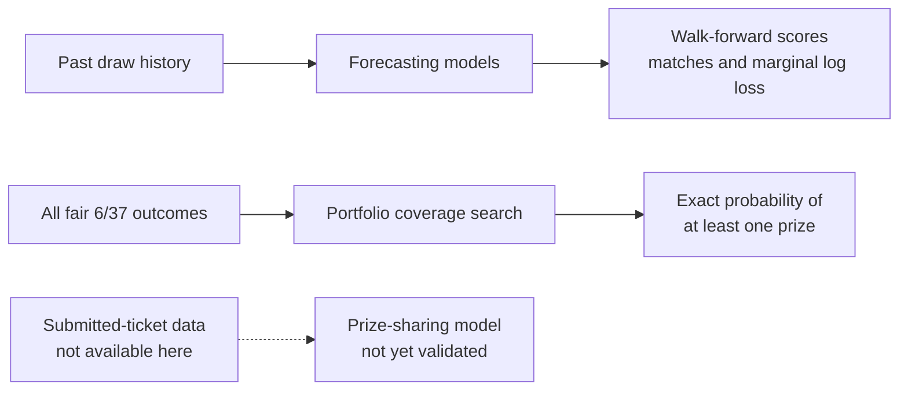

# The approaches

Forecasting, portfolio coverage, and prize-sharing hypotheses answer different
questions. Their evaluation methods should match those questions.

| Approach | What it evaluates | Evidence and limits |
|---|---|---|
| [Statistical](statistical.md) | Frequencies, gaps, pairs, and persistence | No predictive advantage established after correction in the research benchmark |
| [Neural set prediction](set-prediction.md) | Learned marginal ball probabilities | Evaluated walk-forward; larger capacity has not established better prediction |
| [Legacy sequence models](legacy-models.md) | Position-based sequence outputs | Separate evaluation stack; sorted-target and sampling caveats apply |
| [Ticket generators](ticket-generators.md) | Joint coverage and popularity heuristics | Exact coverage gains measured; financial-return gains unverified |
| [Date-conditioned generative](date-conditioned.md) | Set probabilities conditioned on date | In-sample reconstruction is separate from future-draw performance |
| [The perfect-fit function](perfect-fit.md) | Extrapolation from exact historical fits | A perfect historical fit does not establish the generating process |
| [Chaos theory](chaos.md) | Analogues and temporal structure | Tested forecasting rules have not established predictive skill |
| [The golden ratio](golden-ratio.md) | Deterministic schedules and controls | No measured advantage in predicting future draws |

## Choosing an objective

For prediction accuracy, use the [walk-forward benchmark](../evaluation.md),
proper probability scores, and a frozen prospective protocol. Reusing an archive
to select an architecture or window can bias a retrospective result.

For the chance of at least one prize at a fixed row count, use the
[coverage optimizer](ticket-generators.md#exact-coverage-at-a-fixed-ticket-count).
It counts all possible main draws and accepts only exact coverage improvements.
That guarantee applies to its three-or-more-main-match objective, not to every
larger prize category or net profit.

For reduced prize sharing, the existing popularity weights are hypotheses. A
validated payout model needs submitted-ticket or suitable winner/payout data.
A ticket that looks unusual is not automatically more valuable.
