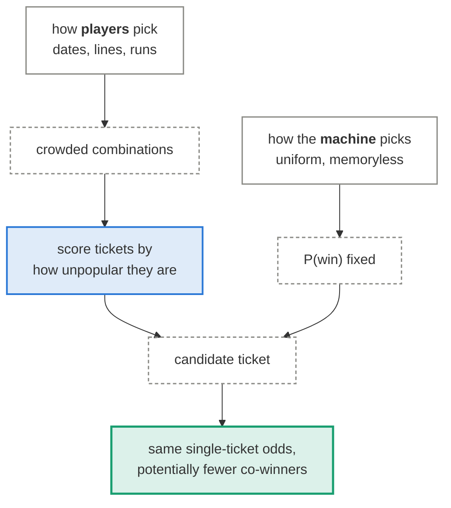
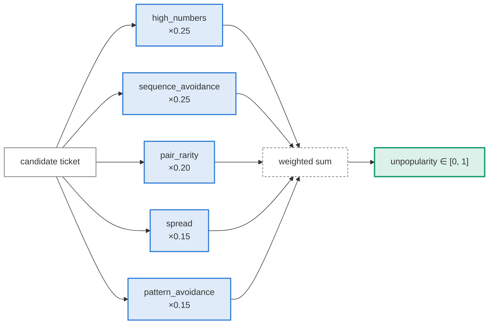
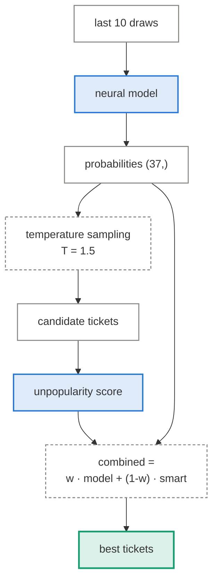
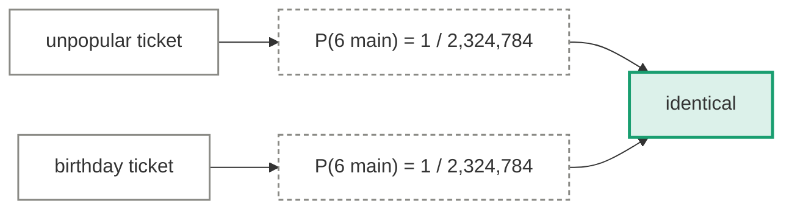

# Ticket generators

!!! abstract "The concept, in a minute"

    **The idea.** Every individual full combination has identical jackpot odds under a
    fair draw. With several tickets, their overlap affects the chance of at least one
    smaller prize. Player choices can also affect how a shared prize is divided.

    **How it works.** The new coverage generator selects complementary tickets and
    verifies their odds exactly. The legacy smart and hybrid generators score
    popularity heuristics; those scores have not been validated as payout estimates.

    **What it teaches.** Coverage, draw prediction, and prize sharing are different
    objectives. We measured a coverage improvement; a forecasting or financial-return
    advantage has not been established.

Coverage: `bench/portfolio.py` and `scripts/optimize_ticket_coverage.py`.
Legacy heuristics: `smart_generator.py` and `predict.py`.

<div class="role-key">
  <span class="k-data"><i></i>data</span>
  <span class="k-learn"><i></i>learned / scored</span>
  <span class="k-op"><i></i>fixed operation</span>
  <span class="k-out"><i></i>output</span>
</div>

## Exact coverage at a fixed ticket count

The eighth prize tier requires three main matches without the strong number, so
the event “at least one prize” is exactly “at least one ticket matches three or
more main numbers.” See [the official prize table, section 21](https://www.pais.co.il/download/files/Lotto-8306.pdf).

The optimizer greedily covers synthetic fair draws, then enumerates all
2,324,784 possible main draws to evaluate the selected portfolio. Exhaustive
evaluation handles overlap between tickets without assuming independent wins.
It now follows that search with up to two passes of exact one-number exchanges.
Each accepted exchange must strictly increase three-or-more-main-match coverage.
Other prize categories are not the optimization objective and can move differently.

In the 2026-11-06 experiment, five portfolios per generator, each with ten rows,
gave these averages:

| Generator | P(at least one prize) |
|---|---:|
| Random | 34.56% |
| Legacy smart | 25.98% |
| Legacy coverage | 32.21% |
| New greedy coverage | 38.40% |

These are exact probabilities for the tested portfolios, averaged over five
seeds. The search is a heuristic, not a proof of optimality. Every portfolio had
ten distinct full combinations and the same jackpot probability:
10 / 16,273,488, approximately one in 1,627,349. A prize may not cover all ticket costs.

```bash
uv run python scripts/optimize_ticket_coverage.py --count 10 --seed 0 --out /tmp/lotto-coverage.json
```

The second iteration compared the initial and refined portfolios for 20 fixed
seeds (0–19), with identical ten-row budgets and initial search settings:

| Method | Mean any-prize probability | Range across 20 portfolios |
|---|---:|---:|
| Initial greedy search | 38.354% | 38.196–38.542% |
| After two exact refinement passes | **38.578%** | **38.563–38.585%** |

All 20 improved. This paired gain is **0.224 percentage points**, not a
prediction-accuracy gain or a proof of a globally optimal portfolio. These
20-seed averages should not be confused with the earlier five-seed comparison.

The JSON includes tickets, configuration, exact match counts, odds, and a swap
audit. `--refine-passes 0` disables refinement. The compiled evaluator reuses
about 31 MiB of immutable outcome arrays; its first call includes JIT cache
loading or compilation. Oversized simulated searches are rejected before
allocation using a conservative working-memory estimate.

The full
[research report and raw results](https://github.com/Timorleiderman/ILotto/blob/main/experiments/prediction_probability_research.md)
document the methods and limits.

## Prize sharing: a separate hypothesis

For tiers with shared prize pools, another player's choice can affect your payout
conditional on winning. Each individual combination still has the same tier
probabilities under a fair draw:

\[
\mathbb{E}[\text{payout}] = \sum_t P(\text{tier}=t)\,
\mathbb{E}[\text{payout}_t\mid\text{tier}=t]
\]

An [Israeli study of manually selected tickets](https://www.cambridge.org/core/journals/judgment-and-decision-making/article/patterns-in-manually-selected-numbers-in-the-israeli-lottery/F7167C1DD46E4876DAFCDDD6CE8F238C)
found nonuniform player preferences in 2018 data. That motivates studying prize
sharing; it does not validate this repository's heuristic weights or quantify
their expected return. Current full-ticket popularity data are absent.



!!! note "Popularity needs its own evidence"

    A number appearing rarely in winning draws says nothing about how many people
    bought it. A popularity model needs submitted-ticket data or a validated proxy.

## The unpopularity score

`TicketScorer.score_ticket` combines five components into a weighted total in `[0, 1]`:

| Component | Weight | Rewards | Intended rationale |
|---|---:|---|---|
| `high_numbers` | 0.25 | including numbers above 31 — outside the calendar range | player behaviour |
| `sequence_avoidance` | 0.25 | no arithmetic progressions (`4, 8, 12, 16` is a popular pick) | player behaviour |
| `pattern_avoidance` | 0.15 | not matching known slip patterns (lines, diagonals) | player behaviour |
| `spread` | 0.15 | even gaps and wide range coverage, rather than clustering | player behaviour |
| `pair_rarity` | 0.20 | pairs that co-occurred rarely **in past draws** | nothing — see below |



!!! warning "`pair_rarity` does not measure popularity"

    `TicketScorer._analyze_historical_patterns` builds `pair_frequencies` by counting pairs in
    the **draw archive** — the machine's output, not anybody's ticket. Which pairs the machine
    happened to draw says nothing about which pairs players choose, and the
    [pairwise co-occurrence test](../evaluation.md) confirms those counts are consistent with
    chance. So this component contributes 20% of the weight and carries no information in
    either direction.

    Fixing it properly needs data this repo does not have: the distribution of *submitted
    tickets*, or a validated proxy using winner counts and prize information.

The other four encode hypotheses about player behaviour. Their direction,
weights, and combined ticket ranking still need validation; an aesthetically
spread ticket may itself be popular.

## The hybrid generator

`smart_generator.py --model multi_output` blends a network's probabilities with the
unpopularity score:



The [benchmark](../results.md) has not established a predictive advantage for
the neural models. The heuristic half also lacks a measured payout advantage.

!!! note "`--model-weight 0` is not a pure-smart mode"

    The weight only drops `model_score` out of the final **ranking**. Every candidate ticket is
    still *sampled* from the model's probability distribution — `generate_hybrid_tickets` calls
    `get_model_probabilities` before the loop and draws all six balls from it regardless of the
    weight. So the model still decides which tickets are ever considered.

    In practice this costs little, because the model's distribution is almost uniform, so
    sampling from it is close to sampling at random. But "weight 0 removes the model" is not
    true of the current code. A genuine pure-smart path would sample candidates uniformly;
    `smart_generator.py --count N` with no `--model` does exactly that.

Temperature sampling adds diversity. Its effect on prize sharing cannot be
quantified without knowing which tickets other players actually submit.

## What this does not do



Matching all six main numbers is not necessarily a jackpot: the strong number
must also match. One complete ticket's jackpot probability is 1 / 16,273,488.
Neither portfolio coverage nor the popularity heuristics establish positive
expected profit.

---

Measured results: [Results](../results.md).
