# ILotto

A reproducible study of the Israeli Lotto (6 of 37, plus a strong number 1–7): what can be
measured, what can be predicted, and what a ticket buyer can actually control. It is built to
be taught, from basic probability to neural networks and exact algorithms.

[Start here: the game in five minutes](start/the-game.md){ .md-button .md-button--primary }
[Run it yourself](start/run.md){ .md-button }

---

## The story, from basics to advanced

Each chapter builds on the one before. Every claim is a command you can run.

| | Chapter | The question | What you learn |
|---|---|---|---|
| 1 | [The game](start/the-game.md) | What are the odds? | Counting, the hypergeometric distribution, the two baselines: 0.973 matches and 4.18% |
| 2 | [Measuring honestly](evaluation.md) | How do you know a result is real? | Leakage, walk-forward backtesting, exact nulls, multiple-testing correction |
| 3 | [Simple strategies](approaches/index.md) | Do hot numbers, due numbers or patterns work? | Why each folk method fails, with its own mechanism |
| 4 | [Neural networks](approaches/set-prediction.md) | Can a network find what counting misses? | Sequence models, set prediction, a generative model, memorisation versus prediction |
| 5 | [Probability forecasts](algorithm-research.md) | Can we forecast the whole draw, not just six numbers? | Proper scoring, expert mixtures, training on simulated data |
| 6 | [Algorithms for the ticket](levers/index.md) | Given a budget, which rows? | Covering designs, exact search with bit masks, dynamic programming |
| 7 | [Side quest](side-quests/seed-search.md) | What if the lottery had a seed? | Exhaustive search in Python, Rust and CUDA |

## What was found

**The draw cannot be picked.** Nineteen strategies, from hot numbers to a Transformer, were
replayed draw by draw over the latest 300 of 1,661 draws, each seeing only earlier draws. None beats a random ticket after correcting for the number
of strategies tried. [Live scoreboard](results.md).

**Looking impressive is cheap.** A lookup table reconstructs every past draw, 6.000 numbers out
of 6, and scores chance on the next one. [Memorisation versus prediction](approaches/date-conditioned.md).

**The ticket can be designed.** One row wins a prize in 4.18% of draws. Ten rows chosen to overlap
as little as possible win in 38.60%, and fourteen in 51.01%, counted exactly over every possible
draw. [Coverage](approaches/ticket-generators.md).

**Three bugs once looked like skill.** An earlier version reported 30% accuracy. Filtering by
ball value, reading the archive backwards and grading sorted balls produced all of it.
[How it is measured](evaluation.md).

## How the measurement works

```mermaid
flowchart LR
  D["draw archive<br/>1968 → today"] --> E["era filter <b>by date</b><br/>1,600+ draws, one game"]
  E --> W["walk-forward<br/>no lookahead"]
  W --> M["matches vs 0.973<br/>log loss vs ln 37"]
  M --> C["Holm–Bonferroni<br/>+ Monte-Carlo null"]
  C --> R["published report,<br/>rebuilt after every draw"]

  class D data
  class E,W,M,C op
  class R out
  classDef data fill:none,stroke:#8a8a85,stroke-width:1.5px
  classDef learn fill:#2a78d626,stroke:#2a78d6,stroke-width:2px
  classDef op fill:none,stroke:#8a8a85,stroke-width:1.5px,stroke-dasharray:4 3
  classDef out fill:#199e7026,stroke:#199e70,stroke-width:2.5px
  classDef flaw fill:#e3494826,stroke:#e34948,stroke-width:3px
```

!!! note "Scope"

    These results describe this archive and these methods. Passing a randomness test is not
    proof of perfect randomness, and winning a small prize more often is not a profit: the
    expected return of a row stays below its price.
