```mermaid
flowchart LR
  D["draw archive<br/>1968 → today"] --> E["era filter <b>by date</b><br/>1,600+ draws, one game"]
  E --> W["walk-forward<br/>no lookahead"]
  W --> M["matches vs 0.973<br/>log loss vs ln 37"]
  M --> C["Holm–Bonferroni<br/>+ Monte-Carlo null"]
  C --> R["published report,<br/>rebuilt after every draw"]

  class D data
  class E,W,M,C op
  class R out
  classDef data fill:none,stroke:#8a8a85,stroke-width:1.5px
  classDef learn fill:#2a78d626,stroke:#2a78d6,stroke-width:2px
  classDef op fill:none,stroke:#8a8a85,stroke-width:1.5px,stroke-dasharray:4 3
  classDef out fill:#199e7026,stroke:#199e70,stroke-width:2.5px
  classDef flaw fill:#e3494826,stroke:#e34948,stroke-width:3px
```

# ILotto

An honest benchmark of lottery-prediction methods against the Israeli Lotto (6/37 + strong
1–7), with every approach in the repository documented, diagrammed, and scored against the
same exact null.

[Open the live benchmark report](benchmark/index.html){ .md-button .md-button--primary }
[How each approach works](approaches/index.md){ .md-button }

---

## The short version

Every strategy in this repository — counting heuristics, Markov models, GRU and Transformer
networks, a date-conditioned generative model, exact interpolators over the whole history,
and chaos-theoretic analogues — is backtested walk-forward against 1,600+ draws. **None beats a randomly filled ticket by a
margin that survived multiple-testing correction in the November 6 research run**.
Its probability-emitting models also had worse marginal log loss than uniform.
These results have not established a prediction advantage; they do not prove
the absence of every possible signal.

That is the expected answer. The value here is the measurement:

## Where to start

- :material-scale-balance: **[How it is measured](evaluation.md)**

    The walk-forward harness, the two scoring rules, and the three data bugs that made the
    old numbers look like signal.

- :material-shape-outline: **[The approaches](approaches/index.md)**

    Diagrams and explanations for every method: statistical rules, neural set prediction,
    the four legacy sequence models, and the ticket generators.

- :material-chart-box-outline: **[Results](results.md)**

    The current scoreboard, regenerated from the latest run.

- :material-book-open-variant: **[Reference](reference/architectures.md)**

    Layer-by-layer deep dive and the full user guide.

## What portfolio coverage improves

At a fixed ticket count, choosing complementary rows can increase the probability
of at least one smaller prize. The coverage optimizer verifies every accepted
refinement against all possible main draws. Jackpot odds still depend on the
number of distinct full combinations. See [ticket generators](approaches/ticket-generators.md)
for exact results, the command, and the distinction from unvalidated prize-sharing heuristics.

!!! note "Scope of the evidence"

    Passing a randomness test does not prove perfect randomness. A smaller-prize
    win does not necessarily cover the cost of the portfolio, and neither the
    prediction models nor the coverage optimizer establish positive net returns.
