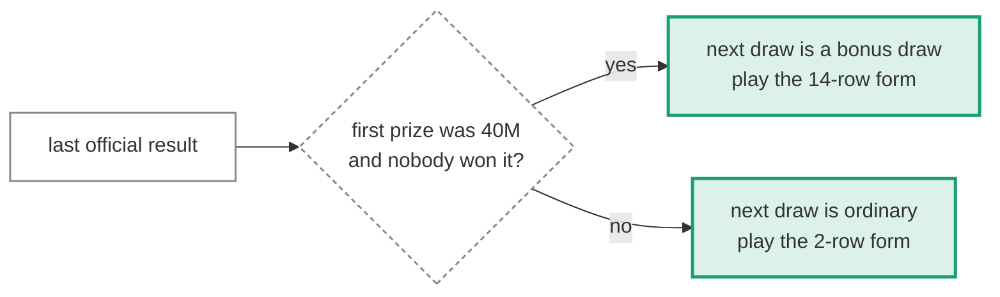

# Which draw to play

!!! abstract "The concept, in a minute"

    **The question.** Is every draw equally worth playing?

    **The answer.** No. A draw that follows an unclaimed 40 million NIS jackpot pays every
    small prize 1.5 times as much, at the same odds. The planner reads the last official
    result and tells you which kind of draw comes next.

    **Why it matters.** It is a rule you can check against the official results, and it
    needs no prediction at all.

Code: `lotto/tickets/draw_plan.py` (the rule and the two forms),
`lotto/experiments/draw_planner.py` (the command).

## The idea

Prizes below the jackpot are normally 10 NIS for three numbers and pool shares above that. In a
*bonus draw* they pay 1.5 times as much: 15 NIS for three numbers. The chance of winning does not
change. What changes is what a win is worth.



## How it works

The rule was measured on 583 official prize tables, draws 3400 to 3982:

| What happened | What came next | Count |
|---|---|---:|
| A 40M first prize was not won | a bonus draw | 24 of 24 |
| The jackpot reached 40M for the first time | an ordinary draw | 7 of 7 |

The operator also announces promotional bonus series at lower jackpots. Those cannot be read from
a result page, so you pass them in with `--bonus`.

The planner then picks one of two fixed forms. Both are [coverage designs](../approaches/ticket-generators.md)
with [exactly assigned strong numbers](../ticket-chances.md):

| Form | Rows | Cost | Chance of any prize | Chance of 3+ and the strong number |
|---|---:|---:|---:|---:|
| Ordinary | 2 | 6 NIS | 8.33% | 1.19% |
| Bonus | 14 | 42 NIS | 51.01% | 8.33% |

## Run it

```bash
uv run lotto plan                  # reads the latest result from pais.co.il
uv run lotto plan --bonus          # a bonus series was announced
uv run lotto plan --draw-id 3982   # plan from a specific past draw
```

It prints the reason, the form, its rows and its exact odds.

## What it teaches

A lottery has two questions that are usually mixed up: *will I win* and *what is a win worth*.
Nothing here changes the first. The second is public information, and using it is bookkeeping.

## Limits

!!! note "What the planner does not do"

    It does not predict numbers; a consistent relabelling of both forms has the same odds.
    Bonus draws attract more players, so pool prizes are shared among more winners. A prize
    is not a profit: the expected return of a row stays below its price.

## Go deeper

- Tests: `tests/test_draw_plan.py` parse saved result pages and check the rule.
- Related: [coverage](../approaches/ticket-generators.md), [strong numbers](../ticket-chances.md).
