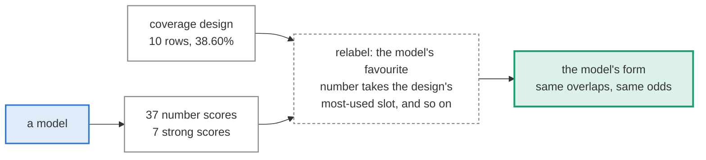

# Every model's form for the next draw

!!! abstract "In one minute"

    **The question.** If you let each model in this project fill a 10-row form for the next
    draw, what would each one write?

    **The answer.** One command prints it: every model's single best ticket, its record on
    the scoreboard, and a complete form. Every form has the same exact odds, a prize in
    38.60% of fair draws, because each is the same coverage design filled with different
    numbers.

    **Why it matters.** It joins the two halves of the project: the forecasts from chapters
    2–4 choose the numbers, and the coverage algorithm from this chapter arranges them.

Code: `lotto/tickets/model_forms.py` (turning a forecast into a form),
`lotto/experiments/predict.py` (the command).

## Run it

```bash
uv run lotto predict
```

About 20 seconds with the three trained models (GRU, Transformer, date-conditioned), and a
few seconds with `--quick`, which skips them and needs no TensorFlow. It first checks pais.co.il for
new draws, like the report (`--offline` skips that). The tables print in the terminal and are
saved to `results/predict/` as Markdown and JSON.

| Option | What it does |
|---|---|
| `--rows 2`, `--rows 10`, `--rows 14` | the size of the form, one per exact coverage design (default 10) |
| `--model hot` | only models whose name contains "hot" |
| `--quick` | skip the three trained models |
| `--offline` | use the committed archive without checking for new draws |

## What you get

A summary table first, one line per model:

| Model | Best single ticket | Strong | Scoreboard |
|---|---|---:|---:|
| Hot numbers (last 100 draws) | ` 1  2  7 18 21 35` | 2 | 1.083 |
| Lag-1 persistence | `11 21 25 27 29 35` | 1 | 1.070 |
| … | | | |

**Best single ticket** is the model's six highest-scored numbers and its top strong number,
exactly the ticket the [scoreboard](../results.md) scores it on. **Scoreboard** is the mean
number of matches it achieved per draw over the latest 300 draws, against 0.973 for a random
ticket.

Then one form per model, ready to copy onto the slip:

| Row | Numbers | Strong |
|---:|---|---:|
| 1 | ` 3  4  5 31 35 37` | 1 |
| 2 | ` 2  6 14 22 25 36` | 7 |
| … | | |

## How a forecast becomes a form



Writing a model's top numbers into ten rows directly would make the rows overlap heavily and
lower the chance of any prize. Instead the form starts from the [coverage design](../approaches/ticket-generators.md),
whose rows overlap as little as possible. Each number in the design is replaced by another, the
same way in every row: the number the design uses most often becomes the model's favourite, the
next most used becomes its second favourite, and so on. The strong numbers are relabelled the same
way. Because every row changes the same way, every overlap between rows is preserved, so the form
keeps the design's exact odds. The same method was used in the [1,000-draw test](../historical-strikes.md).

## What it teaches

Prediction and arrangement are separate problems. The models disagree about which numbers to play,
and none of them has beaten a random ticket on the scoreboard; the arrangement, which no model
touches, is where the measurable gain is.

## Limits

!!! note "What the forms do not change"

    Every model's form has the same chance of a prize, because the odds come from the design,
    not from the numbers in it. Choosing between the models is a matter of taste, not of odds.

## Go deeper

- Tests: `tests/test_model_forms.py` checks that every form keeps the design's exact odds and that
  a model's favourite numbers fill the most rows.
- Related: [coverage](../approaches/ticket-generators.md), [strong numbers](../ticket-chances.md),
  [which draw to play](draw-planner.md), [the scoreboard](../results.md).
