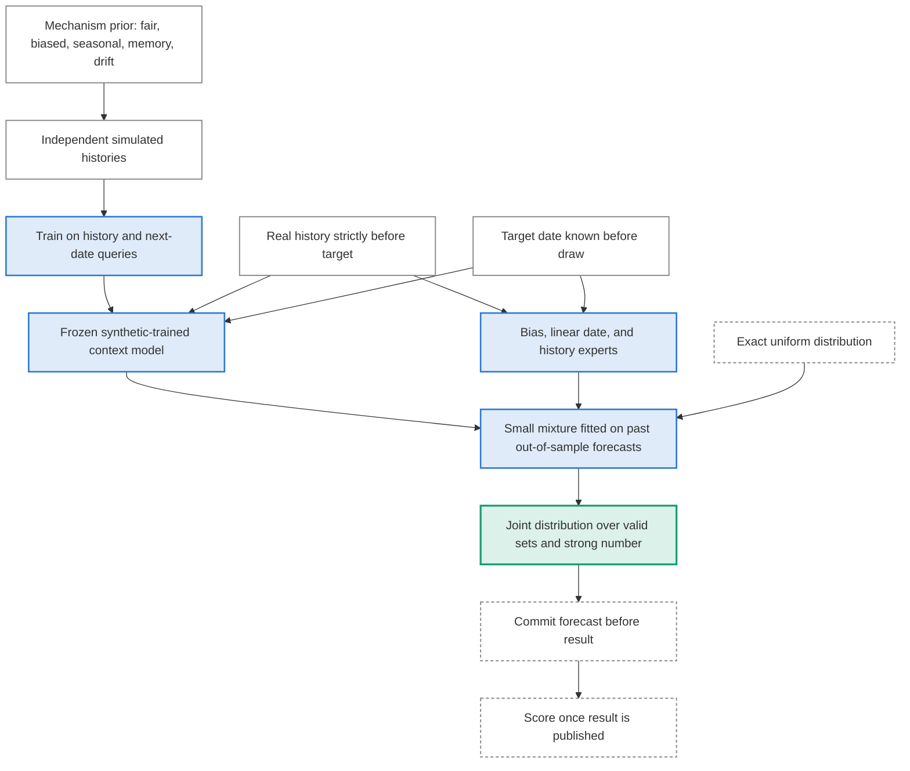

# Unified lottery model: architecture and implementation plan

Design date: 2026-11-06, Asia/Jerusalem. Status: combined-model architecture proposed; the bounded seed-search pilot in section 12 is implemented. No neural model has been trained for this proposal.

## 1. The idea to build

Train a model on **many simulated lottery worlds**, each with its own hidden generating mechanism. Give it a short history from a previously unseen world and ask for the probability distribution of that world's next draw, conditioned on its date. Then apply the same inference procedure to the real archive, combining it with small statistical models in one probabilistic forecast.

This preserves the intended idea—large synthetic training data, small real data, one combined model—while giving the synthetic data something useful to teach: how to infer a mechanism from limited observations and how to remain uncertain when observations contain no predictive information.

Working name: **Synthetic-World Lottery Model (SWLM)**. This is a proposed adaptation of prior-data fitted networks and probabilistic ensembles, not a claim of a new learning theorem or a demonstrated lottery advantage. PFNs train across synthetic tasks to approximate prediction given a new task's observations; that is the research precedent for the central component. [Müller et al., Transformers Can Do Bayesian Inference](https://arxiv.org/abs/2112.10510).

### What “works” means

There are three different outcomes:

1. **Reconstruction:** reproduce known draws. A lookup table can do this perfectly.
2. **Prediction:** assign better probabilities to unseen draws than a uniform model, consistently under a predefined evaluation procedure.
3. **Exact hit:** choose all six numbers and the strong number for one future draw.

The engineering target is outcome 2. Outcome 3 is recorded, but is too rare to be the training objective or the sole measure of progress. Outcome 1 remains a diagnostic control.

The probability of guessing a winning combination is nonzero. Under independent fair 6/37 + strong 1–7 draws, however, every predictor using only prior draws and dates has the same exact-hit probability for a single committed ticket:

\[
P(\text{exact hit}) = \frac{1}{\binom{37}{6}\,7}
= \frac{1}{16,273,488}.
\]

The format is described by the [official Lotto FAQ](https://www.pais.co.il/info/faq.aspx); the combination count above is calculated directly. A nonzero probability of a hit does not imply an identifiable predictive function. Synthetic random observations independent of the real mechanism cannot add information about its future outcomes. We can test departures from the fair-independent model; we cannot assume them into existence.

Even determinism would not be enough by itself: date and published results may omit the physical state needed to predict the next draw. Infinitely many functions agree with the observed history and disagree on the next result, and infinitely many agree with any particular next result too. Perfect historical fit cannot select the correct continuation.

## 2. Repository findings and boundaries

Inspected locally on the design date:

| Existing asset | Role in this design |
|---|---|
| `bench/data.py` | Chronological, date-filtered modern-era loader; call without writing or refreshing for reproducible experiments |
| `bench/generative.py` | Exact conditional-Bernoulli set probabilities, marginals, sampler, and linear date model |
| `bench/backtest.py` | Existing chronological predictor evaluation; extend through a separate joint-probability evaluator |
| `bench/predictors.py`, `bench/nn.py` | Existing statistical and neural comparison models |
| `bench/spacetime.py`, `MemorisingDateLookup` | Perfect-fit negative controls |
| `tests/test_pipeline.py`, `tests/test_generative.py` | Existing leakage, normalization, and control tests |
| `docs/benchmark/results.json` | Previously generated evidence, not a fresh evaluation of this proposal |

The local modern-era archive contains **1,632 draws, 2012-01-03 through 2026-08-04**. The saved report was generated on 2026-08-05. It reports no corrected significant strategy advantage. These are facts about the inspected snapshot, not claims about results through November 2026.

Keep work in the benchmark stack. Do not introduce an `ilotto/` package that shadows `ilotto.py`, use the legacy outcome-filtered CSV, change the existing linear date head into a nonlinear memorizer, or hand-edit generated results. The new synthetic model is a separate predictor with its own tests.

The initial design was followed by a bounded seed-search implementation, local pilots, and an official archive refresh. The refreshed archive contains 1,661 modern-era draws through 2026-11-03; the original 1,632-draw snapshot is preserved for audit. No giant dataset generation, neural training, or next-draw forecast has been performed. See `experiments/seed_search_pilot.md` and `experiments/seed_search_campaign.md` for measured results and limits.

## 3. Architecture



One inference entry point returns one distribution. Internally, five expert distributions contribute:

| Expert | What it represents | Learning on real history |
|---|---|---|
| Uniform | Independent fair draws | None |
| Static bias | Persistent deviations in ball/strong frequencies | Regularized intercepts |
| Calendar | Smooth seasonal and weekday effects | Existing linear date model, with regularization selected chronologically |
| History | Recency and lag effects | Small shared-coefficient model, not an unrestricted 37×37 transition model |
| Synthetic context model | Mechanism inference learned across simulated worlds | Frozen weights; real observations enter as context |

“Combine everything” means combine compatible predictive distributions. Existing chaos, golden-ratio, polynomial, LSTM, and transformer methods remain comparisons or controls initially. Rankings and seven independent positional predictions cannot be treated as exact joint probabilities without a separately specified probabilistic model. Adding every existing output indiscriminately would make calibration less interpretable.

## 4. A valid probability model for a lottery draw

Let `H` be observations available before the draw, `d` its scheduled date, `S` an unordered six-element subset of 1–37, and `b` the strong number in 1–7.

For each component, use the repository's conditional-Bernoulli distribution:

\[
q_k(S,b\mid H,d)=
\frac{\exp\{\sum_{i\in S}\theta_{k,i}(H,d)\}}
{e_6(\exp\theta_k(H,d))}
\;\operatorname{softmax}(\eta_k(H,d))_b.
\]

`e_6` is the sixth elementary symmetric polynomial. The existing dynamic program computes its log exactly in O(37×6); no enumeration of millions of tickets is needed. All-zero logits give the exact uniform distribution.

The synthetic context expert produces **four** such components and their mixture weights. The top-level model then mixes the five experts:

\[
q(S,b\mid H,d)=\sum_{j=0}^{4}w_j q_j(S,b\mid H,d),
\quad w_j\geq0,\quad\sum_jw_j=1.
\]

Initial real-data mixture weights are global within each refit interval, not outputs of another neural network. Fit the four free weights using historical **out-of-sample** expert forecasts. Constrain the uniform weight to at least 0.05 as a design default, and allow it to equal 1 exactly. This floor limits overconfidence but does not itself establish calibration. Compare the fitted mixture against the all-uniform solution on an earlier validation block; use uniform when the fitted solution fails the predefined selection rule.

Mixtures combine probabilities, not logits. Compute joint log probability with log-sum-exp. Ball marginals sum to six; strong probabilities sum to one. Sample an expert, then its component if needed, then an exact six-number set and strong number using that same component. Choosing independent components for main and strong numbers would sample the wrong joint distribution.

Within one component the strong number and set are conditionally independent. Mixing components permits some dependencies, but four synthetic components do not represent every possible pairwise or higher-order mechanism. Treat held-out dependency mechanisms as explicit model-mismatch tests.

Center ball and strong logits to remove their additive-constant non-identifiability. Clip neural logits to a configured finite range for stability, fixed using synthetic validation only. Do not replace the exact set likelihood with independent sigmoid thresholding.

## 5. What the large synthetic dataset contains

### Worlds, not unrelated random rows

A training unit is an episode from one hidden world:

1. Sample a mechanism family and latent parameters.
2. Generate a chronological schedule and draw sequence from that mechanism.
3. Select a context prefix and a later query date.
4. Supply observed context draws and the query date to the model.
5. Train against the withheld query draw, which shares the world's mechanism.

The latent parameters and simulator seed are never model inputs. Seed affects simulation randomness, not the target-date encoding. For this pretraining corpus, do not search seeds until they reproduce the real archive, or keep only simulated histories close to the real evaluation labels. Such selection uses those labels for fitting. An explicit seed-search research track is specified in section 12; its matching history is labeled training evidence and kept separate from evaluation.

An IID date-to-random-ticket dataset is the fair-world control. Its correct learned answer is uniform for every date. Covering all possible tickets teaches the support of the distribution; it does not teach which ticket corresponds to the next real date.

### Initial simulator prior

These percentages are experimental design choices, not inferred probabilities about the real lottery:

| World family | Initial sampling share | Hidden mechanism |
|---|---:|---|
| Fair IID | 50% | Uniform independent main sets and strong numbers |
| Static bias | 15% | Small persistent centered ball and strong logits |
| Calendar effects | 10% | Low-order periodic and weekday coefficients |
| Weak memory | 10% | Current logits depend weakly on earlier draws |
| Drift/change points | 10% | Bias changes gradually or switches regimes |
| Combined mechanisms | 5% | Bounded combinations of the preceding effects |

Start nonzero effect scales on a preregistered grid of 0.02, 0.05, 0.10, 0.25, and 0.50 logit units; standardize each world's feature contribution so these scales are comparable. Include strong synthetic effects for learnability checks and effects close to zero for false-discovery checks. Hyperparameters describe the experiment, not an asserted physical effect size.

Use separate train/validation/test world IDs, random streams, and parameter draws. All windows of a world stay in one split. Also hold out mechanism families and effect ranges; a new seed alone is an insufficient transfer test. Randomize absolute calendar offsets and phases so the model cannot memorize a shared date-to-result map. Simulate missing observations and irregular schedules separately from machine dynamics.

Reserve deterministic toy functions, hidden-state chaotic processes, and alternative weighted-without-replacement samplers for challenge tests. Success on a simple deterministic world verifies learnability, not that the real lottery uses that function. In chaotic worlds, distinguish forecasts with observable state from those without it.

### Size and storage

| Stage | Training target | Purpose |
|---|---:|---|
| Smoke | 10,000 episodes | Verify validity, leakage guards, loss, throughput |
| Pilot | 100,000 episodes | Establish fair-world behavior and recovery of planted effects |
| Scale | 1,000,000 episodes | Test whether synthetic transfer improves |
| Optional scale | 10,000,000 episodes | Only if the previous scale improves held-out synthetic performance enough to justify cost |

Draw context lengths from 32, 64, 128, 256, and 512 observations. Validate longer-context inference separately; do not assume extrapolation to thousands of tokens works. Store compact integer draws and dates or regenerate them deterministically from manifests. Avoid materializing one-hot context windows on disk.

At context length 256, one million single-query episodes represent about 257 million simulated draw rows. Seven `uint8` outcomes plus a four-byte date would alone occupy about 2.83 GB before compression, excluding indexing, metadata, and any extra history for summary features; one-hot expansion is much larger. Streaming generation and bounded caches are the default. Count both episodes and draw rows in reports.

Benchmark episodes/second, peak RAM, checkpoint size, and validation quality before approving a scale increase within implementation. Hardware and runtime are currently unmeasured; do not promise an overnight run or add a mandatory GPU dependency.

## 6. Synthetic context model

Start with a small transformer trained from scratch using the existing TensorFlow stack:

- Draw token: 37-way multi-hot main set, seven-way strong one-hot, calendar features, relative age, and observation-gap features.
- Context: recent 256 draws by default; masked shorter sequences during training, at most 512 initially.
- Longer history: a separate fixed summary branch with frequency counts and prespecified exponentially weighted frequencies, computed only from the available prefix. Generate corresponding longer prefixes in synthetic training; never fabricate long-history summaries from a short window.
- Query: date features for the target, with no target result. Use a masked query token attending to context tokens.
- Encoder: four attention blocks, width 128, four heads, feed-forward width 256, and dropout 0.1 as starting values.
- Output: four centered vectors of 37 ball logits, four centered vectors of seven strong logits, and four component weights.
- Loss: negative log probability of the entire held-out six-number set plus strong number under the mixture.

Aim initially for fewer than two million parameters, verifying the actual count once built. A large training corpus does not require a huge parameter count.

Use one withheld query per episode in v1. Context contains strictly earlier observations. If later versions train many queries in one sequence, add causal attention masks so no query sees later results. Attention padding masks are mandatory even in v1.

Train three prespecified initialization seeds and average their distributions if the pilot budget permits; do not select the luckiest seed on real results. An averaged synthetic expert still exposes one normalized distribution. Select capacity and stopping checkpoints using held-out synthetic worlds. Inspect null-world log loss and calibration separately from the average across biased worlds.

The real archive is context, not a source of millions of independent training examples. Freeze this encoder for the first real-data experiment. Fine-tuning all weights to reconstruct the archive is explicitly outside v1. A future adaptation experiment may expose at most 32 predefined adapter parameters, with stronger regularization and its own registered comparison.

Calendar information is a candidate covariate, not a source of randomness or a winning seed. Feature normalization is fitted on the available prefix. Query dates use Asia/Jerusalem calendar semantics. Never invent time-of-day, machine identity, ball weights, environmental readings, or schedule confirmation absent from the source data.

## 7. Real-data adaptation and forecast contract

Build three small real-data experts:

1. **Bias:** regularized main/strong intercepts, equivalent to constant-date logits.
2. **Date:** reuse the existing linear date basis and `fit_cb`; preserve its current capacity guard.
3. **History:** use centered per-number recent frequency, exponential recency, and previous-draw inclusion features. Fit shared coefficients across numbers; choose strong-number features analogously. Fix feature windows before evaluation.

Create out-of-sample expert forecasts on rolling prefixes to fit the top-level mixture. Expert regularization, feature windows, mixture weights, and any fallback selection must all be chosen inside the available training prefix. Refit cadence defaults to every 25 observed draws; the frozen context model may consume the latest available history each draw. The cadence is fixed before outer evaluation.

Proposed interface, in addition to the existing `Predictor.scores` adapter:

```text
fit(history, experiment_config) -> fitted predictor
predict_distribution(history, target_date) -> immutable Distribution
Distribution.log_prob(main_set, strong) -> scalar joint log probability
Distribution.marginals() -> main[37], strong[7]
Distribution.sample(rng, count) -> valid tickets
```

The distribution snapshot must not change when the predictor is refitted. Track the greatest observation date used in fitting, feature normalization, model selection, and context; all must precede the target. Historical scoring and deliberate in-sample reconstruction use distinct entry points.

Forecast artifact fields:

```text
experiment_id, model_version, config_hash, checkpoint_hash
archive_hash, history_end_date, target_date, schedule_source
forecast_created_at, timezone, data_freshness_status
expert_weights, distribution_parameters, main_marginals, strong_probabilities
sampling_seed, committed_tickets, forecast_status
```

Statuses distinguish `research`, `no_detected_advantage`, and `prospectively_validated_advantage`; they never say “guaranteed.” A date inferred from historical cadence is labeled inferred. An official-date forecast requires a verified schedule or an explicit user-supplied target date. Do not silently present a forecast built from the August snapshot as current in November. Real operational forecasts require a freshness check and the latest available preceding results.

For comparison, commit one ticket per method per draw using a fixed seeded sampling procedure. If displaying multiple tickets, keep the same unique-ticket count across methods. Under the fair null, K distinct full combinations cover K/16,273,488 of that draw's outcome space; that is coverage, not learned predictive skill. Model probabilities are estimates conditional on assumptions, not verified winning odds.

## 8. Evaluation that can distinguish signal from fitting

### Data separation

Use synthetic worlds for pretraining and synthetic model selection. Use real chronological prefixes for fitting small experts and mixture weights. Evaluate on later real draws without using their outcomes anywhere in the forecast path.

For historical development, define 60% initial fitting history, 20% rolling selection, and 20% outer replay, with expanding-window inner folds. Freeze exact boundaries in the experiment manifest before execution. Because this repository already examined the archive, **none of these historical partitions is a pristine confirmatory holdout**. Label all such results retrospective. Newly downloaded results that already occurred are also retrospective, even if this particular training run has never seen them.

For confirmation, register one final pipeline and commit forecasts before genuinely future draws occur. Later refits may use earlier revealed results under the fixed refit policy. Do not change model selection rules in response to the confirmatory scores and continue calling the experiment unchanged.

### Primary metric

Use exact joint negative log likelihood, including the strong number:

\[
L_t=-\log q(S_t,b_t\mid H_{t-1},d_t),\qquad
L_{\text{uniform}}=\log(16,273,488)=16.6050478385.
\]

Report mean improvement `uniform_joint_nll - model_joint_nll` in nats per draw. Positive is better. The existing normalized per-ball loss has uniform baseline `ln(37) = 3.6109179126`; it is a different marginal score and must not be compared numerically with joint loss.

Secondary metrics: main-number Brier score, strong-number log loss, calibration by probability bins with uncertainty, mean ticket intersection, counts for each match tier, and exact joint hits. Random-ticket mean intersection is `36/37 = 0.972972973`; strong accuracy is `1/7`. Distinguish forecast calibration from the variability of sampled-ticket scores.

### Comparisons and ablations

Report uniform; regularized static bias; existing linear date model; history expert; synthetic-only; real-experts-only; and the combined model. Include a combined-model ablation without query calendar features, a synthetic model trained only on fair worlds, and the date lookup/perfect-fit controls. Register every tried variant and seed policy. Existing predictors without a joint density participate only in the compatible marginal/ticket tables.

### Null tests, power, and stopping

1. Run the **whole adaptive pipeline**, including inner tuning and mixture selection, on independent fair synthetic archives with the real development schedule. Use at least 2,000 Monte Carlo replicates for the cheap pilot. If the full neural run is too expensive, report a smaller run's resolution explicitly rather than silently substituting fixed-model tests.
2. Use `(1 + exceedances)/(replicates + 1)` for Monte Carlo p-values. Correct across the registered retrospective comparisons with the existing Holm–Bonferroni routine. Repeated unregistered tuning invalidates a simple final-table correction; the full selection procedure must be represented or the result remains exploratory.
3. Measure detection power on planted static, calendar, memory, and drift signals across their effect grid, at real-sized sample counts. Report the smallest effects detected reliably and failure cases. Synthetic recovery is an implementation test, not evidence of real signal.
4. For one locked prospective pipeline against the fair-independent null, track the likelihood-ratio process `E_n = product_t [q_t(actual_t) / p0(actual_t)]`, computed in log space. Since each normalized forecast is committed before the result, this has expectation one under the null and supports an anytime threshold of 20 at level 0.05. This follows directly from conditional expectation and Ville's inequality; it is not a posterior probability that the model is correct. See [Ramdas et al., Game-theoretic statistics and safe anytime-valid inference](https://arxiv.org/abs/2210.01948) for the sequential-inference framework.
5. No resetting that evidence process after a loss. If M prospective candidates are monitored for a claim, allocate the error budget in advance, for example a threshold `M/0.05` per candidate. A changed pipeline starts a separately budgeted experiment; prior unfavorable runs remain visible.

Before prospective launch, choose an operationally meaningful mean log-score gain and evaluation horizon from the synthetic power study. Crossing the statistical threshold is evidence against the specified null, not a guarantee of continued advantage or exact prediction. If evidence never crosses the threshold, report “no detected advantage,” not proof that every possible mechanism is absent. No fixed small sample can guarantee a decisive answer about an arbitrarily tiny effect.

## 9. Implementation sequence

All entries below are future work, in dependency order.

### Phase 0 — Lock the experiment and data contract

- [ ] Create `experiments/sw_lotto_v1.yaml` with snapshot hashes, era rules, temporal splits, world prior, candidate budget, seed policy, forecast cadence, and primary score.
- [ ] Validate duplicate draw IDs/dates, duplicate balls within a draw, numeric ranges, missing values, chronological order, and source provenance. Surface invalid records for investigation instead of filtering by outcomes.
- [ ] Record an availability policy for scheduled dates and historical corrections. Separate retrospective replay from forecasts actually committed before a draw.
- [ ] Establish the prospective registration procedure without generating future-results claims.

Exit: deterministic data snapshot and reproducible split manifest; all current data invariants preserved.

### Phase 1 — Probability interface and small combined baseline

- [ ] Add `bench/distributions.py` for uniform, conditional-Bernoulli, and mixture distribution objects, reusing the existing mathematical primitives.
- [ ] Add `bench/unified.py` with static, linear date, and shared-coefficient history experts and the chronological mixture-fitting procedure.
- [ ] Add a `Predictor` adapter returning genuine inclusion marginals.
- [ ] Add `bench/joint_backtest.py` for per-draw joint scores and immutable forecast records. Keep the existing marginal scoreboard intact.

Exit: valid probabilities, null baseline reproduced exactly, and an end-to-end cheap combined model before neural training.

### Phase 2 — Synthetic world engine

- [ ] Add `bench/synthetic.py`: mechanism families, schedules, streaming episodes, world-level splits, manifests, and independent random streams.
- [ ] Build the 10,000-episode smoke experiment and 100,000-episode pilot configuration.
- [ ] Add planted-signal and intentionally unseen-mechanism test sets.
- [ ] Measure generation throughput and storage/RAM use.

Exit: repeatable worlds with verified ground-truth behavior and no cross-split histories.

### Phase 3 — Synthetic context training

- [ ] Add `bench/meta_model.py` and `scripts/train_synthetic.py` for the masked context/query encoder, exact differentiable set likelihood, four-component output, checkpointing, and resume support.
- [ ] Port the log-partition dynamic program to differentiable TensorFlow operations; check values and gradients against the existing NumPy implementation and small-board enumeration.
- [ ] Evaluate unseen worlds, null calibration, effect-size power, and simulator mismatch before touching real selection scores.
- [ ] Freeze synthetic-trained checkpoints; integrate their distribution into `bench/unified.py`.
- [ ] Increase to one million episodes only if the pilot recovers planted signals and behaves correctly on fair worlds. Increase further only with measured synthetic-validation benefit.

Exit: frozen, versioned synthetic expert that can infer learnable synthetic mechanisms and does not report fictitious information on fair ones.

### Phase 4 — Retrospective experiment and decision

- [ ] Add `scripts/evaluate_unified.py` to execute nested chronological fitting, registered ablations, full-pipeline null simulations, and power studies.
- [ ] Report all candidates, paired per-draw scores, tuning budget, failure cases, runtime, and uncertainty.
- [ ] Select the final pipeline using only the permitted selection blocks; use outer replay once per registered candidate, while labeling it retrospective.
- [ ] If the combined model does not justify complexity, retain the simpler or uniform model. Do not scale just to chase a flattering real-history result.

Exit: a reproducible report supporting a concrete choice, including “no detected advantage” if appropriate.

### Phase 5 — Prospective forecasts

- [ ] Add `scripts/forecast_unified.py` for an explicit target date, freshness verification, immutable distribution export, and committed ticket sampling.
- [ ] Add append-only result scoring, prospective evidence tracking, and a change log for model/configuration versions.
- [ ] Start with local artifacts. Public publication or recurring execution is a separate implementation decision, not part of this design task.

Exit: predictions demonstrably made before outcomes, scored under the registered policy.

## 10. Required implementation checks

| Area | Check that matters |
|---|---|
| Density | Enumerate a tiny board and verify total probability is one for each component and mixture |
| Exact null | Zero logits produce `1/(C(37,6)×7)`, main marginals `6/37`, strong probabilities `1/7` |
| Gradient | Differentiable likelihood gradients match finite differences and existing math |
| Sampling | Six distinct legal numbers; empirical frequencies agree with predicted marginals and joint mixture behavior |
| Time leakage | Modifying any future outcome cannot change an earlier forecast, fitted transform, or selected model |
| Model state | Previously fitted future data cannot be hidden by passing an earlier `history` object |
| Simulation splits | No shared world/seed stream across partitions; target labels and latent simulator parameters absent from inputs |
| Selection leakage | Mixture fitting consumes only historical out-of-sample expert forecasts |
| Calibration | Null simulations expose the complete pipeline's false-positive rate, with Monte Carlo uncertainty |
| Power | Recover sufficiently strong planted effects and document weak/unseen mechanisms that defeat the model |
| Memorization | Lookup achieves perfect reconstruction but receives no credit for future prediction |
| Reproducibility | Snapshot + config + checkpoint + seed reproduces a forecast within declared numerical tolerance |
| Forecast logging | Every prospective record predates its draw; updates do not overwrite prior distributions |

Use the repository's normal lint and test checks for implementation. If report/site integration changes later, run the quick report and strict documentation build too. Do not regenerate benchmark results merely to validate this planning document.

## 11. Design decisions and remaining research uncertainty

**Decided for v1:** synthetic episodes rather than IID row inflation; a small frozen context model; exact unordered-set likelihood; five top-level experts; out-of-sample mixture fitting; uniform as an allowed final answer; chronological real-data evaluation; explicit retrospective/prospective separation.

**Measure before scaling:** training throughput, the utility of larger context and more episodes, simulator-to-real mismatch, sensitivity to the chosen world prior, detection power at approximately 1,600 draws, and whether the combined system improves on its simplest components.

**Revisit only with evidence:** more parameters, more mixture components, a real-data adapter, measured physical covariates, or a different set-distribution family. A physical simulator would require measured physical inputs and a validated observation model; random synthetic physics does not supply missing measurements.

Simulation-based inference research explicitly identifies model misspecification as a reliability problem. The cited RoPE method uses real ground-truth parameter calibration data, which this lottery archive does not provide; it is a caution and research reference, not a ready-made solution for this project. [Wehenkel et al., Addressing Misspecification in Simulation-based Inference through Data-driven Calibration](https://arxiv.org/abs/2405.08719).

The first implementation should therefore be the small exact-probability combined baseline and simulator engine. They make the proposed large synthetic training experiment measurable before substantial compute is spent.

## 12. Additional research track: search for a generating seed

### User hypothesis and its limits

The requested experiment is to keep generating deterministic candidate worlds, search for seeds that reproduce the observed draw sequence, and test whether surviving candidates correctly continue that sequence. This is a legitimate computational hypothesis to investigate. It is different from training on randomly generated rows.

Make the hypothesis precise:

```text
draw_t = G(generator_version, seed, initial_state, schedule, t)
```

Recovering a seed can work when the actual observations were produced by a generator in the searched family, its state and output mapping are represented correctly, and the seed is in the searchable domain. A seed has meaning only together with that generator. An arbitrary simulator's seed is not automatically a seed for the real lottery or the physical world. The existence of a recoverable world seed or parallel physical worlds is not established by this experiment.

Dates, sequence offset, number of generator calls, missing draws, the mapping to six distinct balls, and the strong-number procedure are parts of the hypothesis. Searching these choices increases the candidate count and must be logged. Do not introduce a new free seed or lookup exception for each observed draw; that would store the answer sequence rather than test one generating mechanism.

Finite known mechanisms offer a useful contrast to arbitrary functions: enough observations may uniquely identify a candidate within a specified finite family. That identification is conditional on the family being correct. A finite seed space may instead contain no matching candidate at all, regardless of how many times it is searched.

### A resumable search, not literal infinity

Implementation update: `bench/seed_campaign.py` and `scripts/search_seeds.py --count` provide a shared, locked range ledger that imports the original pilot, fills gaps, and continues without repeating committed candidates. Verified append-only rejection inheritance preserved the first 101 million rejections after the official archive refresh. The optional Rust engine now parallelizes disjoint subranges within each batch; 14 workers measured about 181 million checks/second in the warmed benchmark. A bounded one-hour run was launched on 2026-11-06 at 17:06 Israel time. Details, measured coverage, and status artifacts are in `experiments/parallel_search_plan.md`. Migration with surviving candidates and distributed multi-machine workers remain future work.

Use a persistent enumerator that can continue through finite batches. It has explicit limits on runtime, candidate count, memory, and storage; saves progress; and resumes without repeating completed ranges. Every execution has a stopping point. This design does not authorize an unbounded background job or paid compute.

Enumerate integer seeds without replacement for each fixed generator/configuration. To explore multiple families, use a documented fair schedule so later families are not starved by an unbounded search of the first one. Expanding a finite integer-seed search can eventually cover any particular finite seed, but neither its runtime nor the presence of the true mechanism is guaranteed. There is no uniform random draw from all nonnegative integers.

### Search pipeline

1. **Freeze the observation prefix.** Record its hash and label it search/training data. Later outcomes are unavailable to candidate generation or ranking.
2. **Enumerate candidates.** Each candidate is a complete generator, seed, output-mapping, and alignment specification with a stable identifier.
3. **Replay chronologically.** For exact deterministic matching, reject a candidate immediately on its first mismatch. Matching requires both the unordered main set and the strong number.
4. **Retain survivors.** Store compact candidate specifications and generator states, not all generated worlds. Keep counts by longest exact prefix and a representative bounded sample of failures for diagnostics.
5. **Commit continuation forecasts.** Freeze survivor predictions, the mixture rule, and any single-ticket selection before revealing the next result. If survivors disagree, preserve that uncertainty. Do not select the successful one afterward and claim its ticket was the system's prediction.
6. **Fetch and score.** Save newly published data as a new snapshot; score the previously committed forecast first. Then use the new observation to eliminate candidates or launch the next search batch.
7. **Keep the cumulative record.** A candidate discovered after a draw has only fitted that draw. A restarted search does not erase earlier failures or create a retrospective prediction.

If no candidates survive, report `no_exact_candidate_in_searched_space`. If many survive, report their disagreement and seed-space coverage. Neither condition should be silently converted into “seed found.” A partial-match search, if added, is a separate approximate model with a specified error/noise distribution and its own validation; seed numerical proximity is not assumed to imply similar predictions.

### What search volume buys

Let M = 16,273,488. Under a reference model in which candidate sequences are unrelated to the observations and each has independent uniform draws, the expected number of exact matches to k fixed draws among N candidates is:

\[
\mathbb{E}[\text{survivors}] = N/M^k.
\]

For one billion candidates, this is approximately 61.45 matches to one complete draw and 0.000003776 matches to two consecutive complete draws. This is a null calculation for unrelated random sequences, not a bound on recovering a known generator's planted seed. It illustrates why both the correct generator family and efficient state inference matter more than raw simulation volume.

Simulation attempts can cost much less individually than purchased tickets, but they do not buy chances to win the real draw. They buy computational evidence about the candidate family. Measure total compute cost separately from the number of hypothetical tickets generated. Cheap attempts do not make exhaustive search of an enormous space cheap.

### Implementation status of the controlled feasibility experiment

- [x] Add a versioned deterministic toy world with a hidden seed from a deliberately small domain, initially 0 through 65,535. Keep the hidden seed inaccessible to the search procedure.
- [x] Add `bench/seed_search.py` and `scripts/search_seeds.py` with finite range enumeration, early rejection, checkpoints, cancellation, survivor storage, and complete configuration identifiers.
- [x] Search on a prefix and verify future predictions on a separate continuation. Report observationally equivalent seeds if multiple seeds produce the same prefix; do not require unique recovery when the observations do not identify a unique seed.
- [x] Verify resumptions cover the same candidate set and produce the same survivors as an uninterrupted search, without duplicates or skipped ranges.
- [ ] Test absent-seed and wrong-generator cases; the correct result may be zero survivors, and a history match alone must never be reported as proven recovery.
- [ ] Run matched null experiments on unrelated random histories, counting all tested mappings, offsets, seeds, and families in the search budget.
- [ ] Benchmark seeds/second and extrapolate finite search costs before increasing the domain. Use direct state-recovery methods only when supported by the particular generator's mathematics.
- [ ] Apply the fixed search procedure to a real historical prefix as an exploratory experiment, then commit any survivor forecasts before genuinely future results.

Sequence this bounded toy-seed experiment after the Phase 0 data contract and before large synthetic neural training. It directly tests the user's proposed search mechanism at low cost. Keep it a separate baseline until it provides a normalized probabilistic forecast compatible with section 4.

For prospective probability scoring, a survivor ensemble can be a fixed-weight mixture of point masses at the predicted full combinations, plus the uniform distribution with weight at least 0.05. Choose weights and the no-survivor fallback before observing the target result; use uniform when there are no survivors. This gives nonzero likelihood to every valid outcome, allows joint log scoring, and avoids interpreting a deterministic candidate's confidence as verified certainty. A finite search's survivor frequencies depend on how candidates were enumerated; they are not automatically the real world's posterior probabilities.

Success in the toy experiment establishes that the search machinery can recover an included mechanism. Evidence for a real predictive mechanism would require repeated forecasts recorded before the real outcomes, evaluated under the same multiple-search and prospective rules as the combined model.

### Native execution progress, 2026-11-06

The search now has validated Rust CPU and C++/CUDA GPU implementations of the
same versioned artificial generator. The RTX 3090 pilot measured approximately
6.82 billion first-draw-filtered seeds per second and saved 372.49 billion
non-overlapping real-history checks. None matched two consecutive draws.
Hardware validation, explicit machine range assignments, benchmark results,
checkpoint import status, and remaining distributed scheduling work are recorded
in [the parallel search plan](seed-search-parallel.md). This execution
speedup does not change the evidence standard or establish predictive skill.
