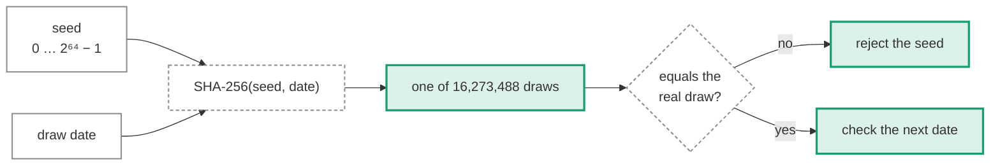

# Side quest: searching for a seed

!!! abstract "The concept, in a minute"

    **The question.** If the draws came from a seeded pseudo-random generator, could we
    find the seed and know every future draw?

    **The answer.** For a generator we define ourselves, yes, and the search recovers a
    planted seed in a fraction of a second. In the original calendar-hash experiment, none
    of the 952 billion tested seeds reproduced the first two archived draws. The alternative
    generator below fits both draws by construction.

    **Why it matters.** It is a clean exercise in exhaustive search, checkpointing and
    parallel hardware: the same loop in Python, in Rust on 14 cores, and in CUDA.

Code: `lotto/seedsearch/` (start with `generator.py`), `native/seed-search/` (Rust),
`native/cuda-search/` (CUDA).

## The idea

The real lottery uses physical ball machines, so it has no seed. This experiment is a *what if*.
It defines an artificial generator, `calendar-sha256-v1`: a 64-bit seed and a calendar date are
hashed with SHA-256 and mapped to one of the 16,273,488 possible draws. A seed is a candidate
"world". The search asks whether any world reproduces history.



## How it works

A wrong seed matches the first draw with probability 1 in 16,273,488, so almost every seed is
rejected after one hash. That makes the search fast, and it makes survivors meaningful: a seed
that matched ten draws by chance would be a 1-in-10⁷² event.

Three engines run the same search and are tested against each other:

| Engine | Seeds per second | Where |
|---|---:|---|
| Python reference | 1.3 million | `lotto/seedsearch/generator.py` |
| Rust, 14 threads (Apple M3 Max) | 237 million | `native/seed-search/` |
| CUDA (RTX 3090) | 6.7 billion | `native/cuda-search/` |

The search is resumable. Completed ranges are recorded in a ledger, so no seed is tested twice,
across restarts or across machines.

## Run it

```bash
uv run lotto run seed-search --mode toy
```

Under a second. It plants a seed, generates draws from it, and recovers it from the draws alone.

```bash
uv run lotto run seed-search --mode real --count 1000000
```

A million seeds against the real archive, with the Python engine.

## Result

| Measure | Value |
|---|---:|
| Distinct seeds tested | 952,605,319,763 |
| Share of the 64-bit space | 0.0000052% |
| Seeds matching draw 1 | about 58,500, as chance predicts |
| Seeds matching draws 1 and 2 | 0 |
| Seeds matching the whole history | 0 |
| Time to search all 2⁶⁴ seeds on both machines | about 85 years |

## What it teaches

Exhaustive search is only as good as the hypothesis it searches. The engines are correct and
fast, and the answer is still "nothing", because the space being searched has no reason to
contain the lottery.

## What if we change the generator?

`uv run lotto run seed-family` tests a second 64-bit generator against the local archive.
It numbers the draws from zero and uses the seed to specify a hash key, a starting offset
and a step. For draw number `i`, its ticket index is
`(calendar_hash(key, date) + offset + i × step) mod 16,273,488`.

For each key, subtracting the first date's hash from its observed ticket index gives the
offset. The second draw then gives the step. These equations account for every seed matching
both draws in one pass over the keys. The smallest matching seed supplies one ticket per
later draw. The experiment also checks every matching seed against draw three.

On the archive through November 14, 2026, **69,656 seeds matched the first two draws, and
zero matched all three**. Across the 1,662 later draws the selected seed averaged **0.961**
main-number matches per ticket. The original calendar hash with seed zero averaged **1.000**
on those dates. The fair-draw expectation is **0.973**. Changing the generator made exact
fits easier to find. Its performance on later draws was consistent with chance.

## Starting from the first real draw

`uv run lotto run seed-chain` uses the first draw as the seed. For each later date, one
chain feeds its own previous prediction into the calendar hash. A second chain feeds in
the previous actual draw. A third uses that same input and adds a learned correction.
After each of its first 1,000 predictions, it calculates the offset between the hash's
ticket index and the observed ticket index, modulo 16,273,488. On the next prediction it
uses the most frequent offset so far, keeping the current offset on ties.

In the archive through November 14, 2026, all 1,000 offsets were different. The experiment
froze the chosen offset and scored the next 663 draws. The corrected generator averaged
0.968 main matches, the free-running chain 0.976 and the chain using the previous actual
draw 1.035. A fair ticket averages 0.973. All three had zero exact tickets. None cleared
the 5% threshold after Holm correction across the three main-match comparisons.
The report in `results/seed-chain.json` includes the prediction and outcome for every draw.

## Generating the whole sequence from one ticket

`uv run lotto run seed-recurrence` takes the January 3, 2012 draw, the first in the modern
archive, as its initial state. It encodes the six balls and strong number as one ticket
index. Each generator then runs forward on its own. Dates label the comparisons.

With the first index as its seed, NumPy's PCG64 generated **4, 6, 18, 19, 24, 36 + strong 4**
for draw two. The archive records **3, 23, 25, 28, 29, 33 + strong 4**.

The experiment also checks every linear congruential rule of the form
`next = (a × current + b) mod 16,273,488`. For each multiplier `a`, the first two draws
determine exactly one increment `b`. This leaves 16,273,488 rules out of 264,826,411,686,144.
Every one fails draw three. The first two indices (12,109,817 and 6,840,865) are odd.
Since the modulus is even, a linear rule taking an odd input to an odd output must do so
for every odd input. The third index (345,408) is even.

As a control, a synthetic sequence starts at zero with `a = 5` and `b = 1`. The first
three tickets identify these constants uniquely. Starting again from the first ticket,
the recovered rule reproduces all 1,000 draws following the fitted three.
The report is written to `results/seed-recurrence.json`.

### Checking a failure and testing a change

Run `uv run pytest -q tests/test_seed_recurrence.py` to verify the first failure.
The test reads draws 2321–2323 from the pinned raw archive, ranks their six-ball sets
by enumerating combinations, and tries each multiplier that can fit draw two. The
direct count agrees with the algebraic search. A separate test changes synthetic draw
500 and checks that the replay identifies that exact draw as its first miss.

The `seed-recurrence` experiment also tests a rule that advances the ticket index by a
step and changes that step by a constant after each draw. The first three tickets set
both constants. The rule then starts again from the first ticket and runs on its own.
On draw four it matched two main numbers and the strong number. It produced zero exact
tickets in the 1,661 draws after fitting. This rules out an exact replay for that rule.
For a prospective test, record the rule, seed and predicted ticket before the draw,
and retain every prediction when scoring later changes.

## Limits

!!! note "What this cannot show"

    Finding no seed says nothing about the real machine; it only rules out one invented
    generator over the tested range. A different hash, seed size or date encoding would be a
    different search.

## Go deeper

- Dated reports: [pilot](../reference/research-log/seed-search-pilot.md),
  [campaign](../reference/research-log/seed-search-campaign.md),
  [capacity](../reference/research-log/seed-search-capacity.md),
  [parallel engines](../reference/research-log/seed-search-parallel.md).
- Tests: `tests/test_seed_search.py`, `tests/test_seed_campaign.py`,
  `tests/test_seed_allocations.py`, `tests/test_native_seed_search.py`,
  `tests/test_cuda_seed_search.py`, `tests/test_seed_family.py`,
  `tests/test_seed_chain.py`, `tests/test_seed_recurrence.py`.
