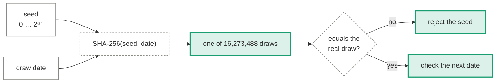

# Side quest: searching for a seed

!!! abstract "The concept, in a minute"

    **The question.** If the draws came from a seeded pseudo-random generator, could we
    find the seed and know every future draw?

    **The answer.** For a generator we define ourselves, yes, and the search recovers a
    planted seed in a fraction of a second. For the real archive, 952 billion seeds were
    tested and none reproduces even the first two draws.

    **Why it matters.** It is a clean exercise in exhaustive search, checkpointing and
    parallel hardware: the same loop in Python, in Rust on 14 cores, and in CUDA.

Code: `lotto/seedsearch/` (start with `generator.py`), `native/seed-search/` (Rust),
`native/cuda-search/` (CUDA).

## The idea

The real lottery uses physical ball machines, so it has no seed. This experiment is a *what if*.
It defines an artificial generator, `calendar-sha256-v1`: a 64-bit seed and a calendar date are
hashed with SHA-256 and mapped to one of the 16,273,488 possible draws. A seed is a candidate
"world". The search asks whether any world reproduces history.



## How it works

A wrong seed matches the first draw with probability 1 in 16,273,488, so almost every seed is
rejected after one hash. That makes the search fast, and it makes survivors meaningful: a seed
that matched ten draws by chance would be a 1-in-10⁷² event.

Three engines run the same search and are tested against each other:

| Engine | Seeds per second | Where |
|---|---:|---|
| Python reference | 1.3 million | `lotto/seedsearch/generator.py` |
| Rust, 14 threads (Apple M3 Max) | 237 million | `native/seed-search/` |
| CUDA (RTX 3090) | 6.7 billion | `native/cuda-search/` |

The search is resumable. Completed ranges are recorded in a ledger, so no seed is tested twice,
across restarts or across machines.

## Run it

```bash
uv run lotto run seed-search --mode toy
```

Under a second. It plants a seed, generates draws from it, and recovers it from the draws alone.

```bash
uv run lotto run seed-search --mode real --count 1000000
```

A million seeds against the real archive, with the Python engine.

## Result

| Measure | Value |
|---|---:|
| Distinct seeds tested | 952,605,319,763 |
| Share of the 64-bit space | 0.0000052% |
| Seeds matching draw 1 | about 58,500, as chance predicts |
| Seeds matching draws 1 and 2 | 0 |
| Seeds matching the whole history | 0 |
| Time to search all 2⁶⁴ seeds on both machines | about 85 years |

## What it teaches

Exhaustive search is only as good as the hypothesis it searches. The engines are correct and
fast, and the answer is still "nothing", because the space being searched has no reason to
contain the lottery.

## Limits

!!! note "What this cannot show"

    Finding no seed says nothing about the real machine; it only rules out one invented
    generator over the tested range. A different hash, seed size or date encoding would be a
    different search.

## Go deeper

- Dated reports: [pilot](../reference/research-log/seed-search-pilot.md),
  [campaign](../reference/research-log/seed-search-campaign.md),
  [capacity](../reference/research-log/seed-search-capacity.md),
  [parallel engines](../reference/research-log/seed-search-parallel.md).
- Tests: `tests/test_seed_search.py`, `test_seed_campaign.py`, `test_native_seed_search.py`.
