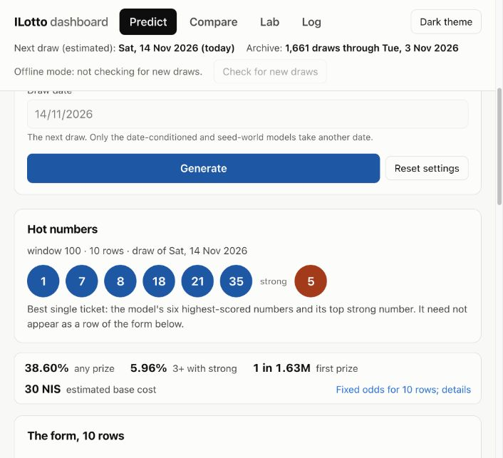

# The dashboard

Explore the models, generate a form, and measure settings against chance on your own machine.

```bash
uv run lotto ui
```

The dashboard opens at `http://localhost:6037` and runs until Ctrl-C. It starts from the local
archive. Only **Check for new draws** contacts pais.co.il; the estimated next date comes from
archive cadence, not an official schedule. A failed check leaves the saved archive usable.

| Option | What it does |
|---|---|
| `--port 7000` | use another port, from 1 to 65535 |
| `--no-browser` | start without opening a browser |
| `--offline` | disable checks for new draws |

Run one dashboard per checkout. A second launch, even on another port, stops with an
explanation before touching the notebook. Open another browser tab to use the running server.



*Example from the pinned test archive through 3 November 2026. Your archive and results may differ.*

## Predict

Choose a model, settings, seed and row count, then press **Generate**.

- **Ticket:** the model's top six and strong number, or a seeded sample in the date-conditioned
  model's sampled mode. This separate ticket need not occur in the coverage form.
- **Odds:** a compact line for any prize, three or more with strong, first prize and estimated
  base cost. Expand it for the full table. Counts are exact under a uniform fair draw for the
  selected stored design; relabelling that design preserves its odds. A prize need not be a profit.
- **Form:** 1, 2, 10 or 14 rows, with a copy button. One row is an illustrative ticket, not a
  claim about the operator's minimum purchase. The cost uses the code's current 3 NIS row rate.
- **Number grids:** ranking scores or relative forecast weights. Focus or tap to inspect a
  value. A normalized weight is not a calibrated probability of being drawn.
- **Record:** a dated reference for a matching benchmark preset. The published report does
  not contain a full configuration manifest, so an exact settings match is unverified.
  Custom settings show no reference. **Test these settings in the Lab** copies the displayed
  result's settings into the Lab, even if you have since changed the controls.
- **Save to log / Open report / Markdown:** use the completed result on screen.

Changing controls leaves the earlier result labelled as stale until you generate again.
Repeated predictions reuse the stored result, including its generation time. The cache key
includes the archive, settings, date/mode, design, schema, implementation and runtime versions.

The date-conditioned model and seed-world toy accept other dates. A past date is a **look
back**, even when the archive has not caught up to it: only earlier draws are used, the actual
result is shown when available, and the output cannot be saved as a future prediction.

## Compare

**Run all models** runs the 19 benchmark presets on one archive/date: 16 quick presets, the
SciPy-based date-conditioned model, and two neural models. Missing TensorFlow makes neural
rows unavailable; a model failure leaves the other rows intact. The seed-world toy is separate.
**Open** applies a row's preset in Predict and generates its form.

The consensus board counts successful rows and shows its denominator. Agreement describes
these methods, many of which read the same history; it is not confidence in a number.

## Lab

Replay the Predict settings over 100–1,000 draws. Each forecast sees only earlier draws.
The result shows the actual evaluation dates/count, mean matches against chance (0.973),
a two-sided finite-sample p-value, and match counts from 0 through 6 beside the chance baseline.

The Lab currently evaluates **top-six tickets**. Date-conditioned sampled mode is disabled
here rather than silently testing a different ticket-selection rule. Switch to top six in
Predict to run that model's backtest. The Lab measures the single ticket, not the whole form.

The notebook survives reloads and records failed/cancelled attempts. Retrying preserves
abandoned attempts; a completed identical comparison is reused. Runs left unfinished when
the server stopped are marked interrupted at the next startup.
Older sampled-mode results that actually measured top-six tickets are retained as **invalid**,
with an explanation, and excluded from the summary and correction. Switch to top six and
run a new backtest to measure those settings correctly.

Holm's step-down correction is recomputed across completed comparisons. This is **exploration**:
choosing new settings after seeing results reuses evaluation data. Correction alone does not
validate that tuning, and a low two-sided p-value can mean *fewer* matches than chance.
Confirmation needs a frozen choice on untouched future draws.

## Log

Save a completed forecast before its target draw. When that exact date appears in the archive,
the Log scores every form row, its strong number and prize tier. The ticket and the form are
shown separately. Entries cannot be edited or deleted in the dashboard.

Same-day saves have unverified timing and stay outside prospective totals: a date-only estimate
cannot establish whether the save preceded the draw. Local timestamps are a personal record,
not independent preregistration. The totals count **forms**, with expectation equal to the sum
of their individual fair-draw prize chances. Several forms on the same draw are correlated.

## Jobs, reports and stored files

One worker runs jobs in order. Prediction, Compare and Lab offer cancellation; it takes effect
at the next safe boundary. A neural fit may need to finish its current stage. Cancelling
before publication prevents a result from being saved. Reloading reconnects to active work.
If a cancellation request cannot reach the server, the page explains the failure and allows
another try. Stopping the server also waits for its current stage to finish safely.

HTML and Markdown reports carry the settings, archive fingerprint and algorithm provenance.
Prediction reports also include the form's design fingerprint and training cutoff. Print from
the HTML report; longer forms and comparisons may use more than one sheet.

Files live under `results/ui/`, which git ignores. Up to 300 completed result files are retained;
log entries include their own copy, so pruning reports does not remove saved predictions.
The notebook and log persist until their owner removes their files. Reads do not rewrite the
archive. Only an explicit check for new draws may update `input/`.
The `.dashboard.lock` file stays in this folder; the operating system releases its lock when
the server stops or crashes. There is no need to delete the file to restart.

## Remote viewing

The server binds only to `127.0.0.1`. To view it from another machine, forward the same port
on both ends, then open `http://localhost:6037`:

```bash
ssh -L 6037:localhost:6037 user@other-machine
```

There is no public hosting mode. The server checks Host, Origin and a per-launch token for
changes, and serves only its fixed static paths. No extra UI dependencies are required.

## Implementation and current limits

| File | Responsibility |
|---|---|
| `lotto/ui/registry.py` | model presets, editable settings and validation |
| `lotto/ui/service.py` | call existing computation and assemble versioned results |
| `lotto/ui/jobs.py` | bounded queue, one worker, cancellation and atomic publication |
| `lotto/ui/storage.py` | immutable results/log entries and the persistent notebook |
| `lotto/ui/server.py` | local HTTP API and request protection |
| `lotto/ui/report.py` | printable HTML and Markdown |
| `lotto/ui/static/` | page, controls and rendering |

Custom form sizes, MLP, epoch-level progress and sampled-ticket backtests are deferred.
TensorFlow availability is detected without importing it; an installed but broken runtime
is reported as a model failure when used. Neither the dashboard nor the benchmark establishes
a predictive advantage.

Next: [how results are measured →](../evaluation.md)
